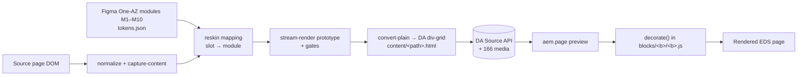

# Benchmark: Fort Street High → AEM EDS with the Stardust reskin (Figma One-AZ v3.2)

| | |
|---|---|
| Source site | https://fortstreet-h.schools.nsw.gov.au/ (52 pages) |
| Design donor | Figma "One-AZ v3.2", file `rsZQmpVzuyn0KhCDA3WN60`, node `6400-21997` |
| Skill under test | `sanyasandal/skills@figma-reskin-m4-on-m2`, commit `1eefc34d`. Scripts are byte-identical copies in `stardust/scripts/` and `stardust/.work/plugin-src/` |
| EDS preview (generated page URLs) | https://fortstreet--stardust-reskin-figma-migration--sanyasandal.aem.page/ (all 52 paths are listed in the per-page table) |
| DA content | https://da.live/#/sanyasandal/stardust-reskin-figma-migration |
| Model | `claude-opus-5.5` for every call, including sub-agents |
| Measured at | 2026-10-21 15:03Z. The report-writing and commit tail after that time is not included |

## 1. Results

| Metric | Value | Source / method | Status |
|---|---|---|---|
| **Pages migrated** | **52 / 52** on aem.page preview (not published) | `stardust/state.json`, `reskin/ledger.json` (`migratedStatus: gated` ×52) | Recorded |
| **Visual similarity to the original, 1440px** | **69.8 %** mean pixel similarity (median 70.8 %, range 40.2–84.0 %) | `pixel-compare.mjs` (branch) with threshold 100, overlap region. 100 − mean differing-pixel 30.23 % | Recorded |
| **Structural similarity (SSIM), 1440px** | **40.7** overlap · 39.8 height-normalized · 47.2 above-the-fold (0–100) | `ssim.mjs` (agent helper) on 4× downscaled greyscale | Recorded |
| Visual similarity, 768 / 390 (3 archetypes) | 49.6 % / 49.8 % pixel · SSIM 17.7 / 12.1 | same | Recorded |
| **Content fidelity** | Text byte-equal to the source on **52/52** pages. Images carried 15/15 on home. 4 pages have accepted image residuals (source `about:error` images ×3, an `<h1>`-wrapped image ×1) | reskin dom-equality + deployed content gates | Recorded |
| **Design fidelity to Figma** | Migrated-output gates: donor-probe 51/52, dom-equality 48/52, slot-coverage 47/52 → **46/52 pages pass all three**. 46 residuals logged, all `accepted` | `reskin/ledger.json` | Recorded |
| **Input tokens** | **152,042,147** (cache read 147,945,500 · cache write 4,093,981 · uncached 2,666) | `~/.copilot/session-store.db` → `assistant_usage_events` | Recorded |
| **Output tokens** | **802,831** (286,708 of them reasoning) | same | Recorded |
| Model calls | 1,278 (main 321 + 7 sub-agents 957) | same | Recorded |
| **Cost** | **6,612.63 AIU** (Copilot AI units: `SUM(total_nano_aiu)/1e9`) | same | Recorded |
| Cost in USD | **Unavailable.** The runtime records AIU only; no AIU→USD rate is exposed to the session | — | Unavailable |
| **Elapsed time** | **4 h 19 m** wall clock (10:44:05 → 15:03:18Z). Of that, **1 h 18 m was blocked** (10:54 → 12:12) on Node permission and DA login. **About 2 h 51 m of active work** (12:12 → 15:03) | session event log | Recorded |
| Model time (sum of call durations) | 155.4 min. Sub-agents ran in parallel, so this is longer than the active wall-clock time | `duration_ms` | Recorded |
| **Prompts** | 17 user prompts (plus 2 empty UI actions) and 7 sub-agent kickoff prompts, verbatim → [`prompts.md`](prompts.md) | `events.jsonl` | Recorded. The system prompt is withheld (runtime-confidential) |

### Token and cost breakdown per agent

| Agent | Role | Calls | Input | Output | AIU | Window (UTC) |
|---|---|---|---|---|---|---|
| main | Orchestration: setup, Figma capture, home reskin, migrate render and gates, fidelity, block library, report | 321 | 40,108,918 | 234,318 | 1,989.28 | 10:44–15:03 |
| `reskin-deploy` (00c3558e) | Home: EDS blocks + DA content + deploy + deployed gates | 283 | 34,589,601 | 163,388 | 1,424.10 | 12:31–13:29 |
| `reskin-archetypes` (6f3a1b89) | Reskin of the `school-life` and `wellbeing` archetypes | 102 | 11,825,458 | 55,430 | 445.76 | 12:57–13:18 |
| `siblings-school-life-a` (5a6a084b) | 11 sibling pages | 94 | 10,088,715 | 49,132 | 412.13 | 13:34–13:57 |
| `siblings-learning-community` (5d58e471) | 12 sibling pages | 53 | 5,542,911 | 39,848 | 289.18 | 13:34–13:53 |
| `siblings-school-life-b` (830fc658) | 12 sibling pages | 64 | 6,763,264 | 47,866 | 327.37 | 13:34–14:03 |
| `siblings-about-us` (3681042d) | 14 sibling pages | 58 | 6,199,778 | 47,929 | 316.52 | 13:34–13:58 |
| `eds-blocks-content` (d6ba2d6f) | 7 extra blocks, 51 pages converted to DA, 166 media, deploy + gates | 303 | 36,923,502 | 164,920 | 1,408.29 | 13:34–14:45 |
| **Total** | | **1,278** | **152,042,147** | **802,831** | **6,612.63** | |

### Timeline

| UTC | Phase |
|---|---|
| 10:44–10:52 | Checkout of `figma-reskin-m4-on-m2` (worktree `~/repos/adobe-skills-m4-on-m2`) and the migration prompt |
| 10:54–12:12 | **Blocked:** Node execution was refused, and DA login was pending. Resumed after the user granted access and logged in |
| 12:12–12:31 | Figma capture (MCP + REST), extract, reskin of home: curate, map, render, gates |
| 12:31–13:29 | Home EDS deploy (sub-agent), in parallel with the 2 archetype reskins (12:57–13:18) |
| 13:34–14:03 | 49 sibling pages reskinned by 4 parallel sub-agents |
| 13:34–14:45 | Extra EDS blocks and DA content for 51 pages, deployed to preview |
| 14:03–14:45 | `migrate render --all`, migrated-output gates, ledger, state → `migrated` |
| 14:45–15:03 | Fidelity run (58 captures), compare composites, DA block library (excat skill) |

## 2. Fidelity: how to read it

A reskin **changes the visual design on purpose**: the original NSW school template is replaced by the One-AZ Figma kit. The pixel and SSIM scores measure how far the new look is from the old site. They are not a quality score. Fidelity is reported on three axes:

1. **Visual similarity to the original.** Pixel and SSIM at the same viewport, each side captured with the same `stitch-shot.mjs --settle`. About 70 % of pixels match at 1440. Most matching pixels are white space, body text and images, which keep their position.
2. **Content fidelity.** Every word and image is carried. Text is byte-equal on 52/52 pages.
3. **Design fidelity to Figma.** The gates check tokens, the type ramp, geometry and module anatomy against the Figma donor. 46/52 pages pass every gate; the rest are accepted residuals.

### Key visual differences (from the composites)

| Area | Original | Migrated | Cause |
|---|---|---|---|
| **Header** | NSW masthead: crest + school name, horizontal mega-nav, search | Unstyled 3-column chrome: no visible logo; skip links, "NSW Government", motto and search buttons stacked on the right; nav labels include the literal `keyboard_arrow_right` ligature. At 390 there is no hamburger and the nav renders as a list | **Defect.** It was already present at home deploy (`.work/deploy/shots/proto-1440-top.png`) and `header.js` is unchanged since then. **This is the largest single visual-fidelity loss** |
| Hero | Full-bleed photo with an overlay card | Light band split: text on the left (serif maroon H1), image on the right | Intentional (Figma M1 hero) |
| Cards | Maroon image cards | Icon/bullet lists (`cards-list`). The `dark`/`off-white` variants render as 2-up panels | Intentional mapping to the M2 teaser list. Visually the largest component change |
| Colour | Dark maroon feature bands (e.g. school tours) | Light grey `columns light` bands | Intentional (M4 CTA banner tokens) |
| Typography | Sans-serif throughout | Serif headings (Lexia → Georgia fallback), maroon/magenta; Inter → Arial body | Intentional. The licensed font isn't served, so the fallbacks render (accepted `font` residual) |
| Layout | Left sidebar nav + breadcrumb on inner pages | Sidebar and breadcrumb dropped; single column | Normalize decision (chrome not in the Figma kit) |
| Accordions | Collapsed | Start open (EW7), which makes wellbeing much taller (5,922 → 18,860 px at 390) | Intentional authoring rule. It also makes the overlap-mode pixel score look better than it is |
| Tables | Bordered | Borderless and full width (except `table bordered`) | Token-driven restyle |
| Page height | e.g. home 5,951 px | home 4,944 px | Sum of the above |

Caveat: pixel compare uses the **overlap** region (the shorter page's height). Pages that grow a lot (accordion-heavy) are compared on their top part only. SSIM height-normalized resizes both captures to the same height and is the fairer whole-page number.

### Per-page fidelity, 1440px (sorted by pixel similarity)

| Page | Pixel similarity | SSIM overlap | SSIM height-norm | SSIM above-fold | Height orig → migrated (px) | Composite |
|---|---|---|---|---|---|---|
| `school-life-uniform-uniform-shop` | 84.0% | 40.8 | 41.1 | 51.4 | 5899 → 7135 | [compare](screens/compare/school-life-uniform-uniform-shop-1440.jpg) |
| `school-life-bring-your-own-device` | 81.8% | 43.5 | 40.9 | 43.2 | 4519 → 4189 | [compare](screens/compare/school-life-bring-your-own-device-1440.jpg) |
| `school-life-student-opportunities-and-activities-academic-competitions` | 81.7% | 40.4 | 41.1 | 48.5 | 5551 → 5707 | [compare](screens/compare/school-life-student-opportunities-and-activities-academic-competitions-1440.jpg) |
| `school-life-travel-to-school` | 81.6% | 41.5 | 41.4 | 49.4 | 6919 → 7932 | [compare](screens/compare/school-life-travel-to-school-1440.jpg) |
| `our-community-foundation` | 80.1% | 42.2 | 42.3 | 40.2 | 5668 → 6142 | [compare](screens/compare/our-community-foundation-1440.jpg) |
| `school-life-canteen` | 80.0% | 44.6 | 44.0 | 49.7 | 4360 → 4195 | [compare](screens/compare/school-life-canteen-1440.jpg) |
| `school-life-bell-times` | 79.8% | 34.5 | 36.5 | 49.1 | 3839 → 4397 | [compare](screens/compare/school-life-bell-times-1440.jpg) |
| `our-community-pandc` | 79.4% | 45.9 | 43.5 | 40.2 | 6275 → 7292 | [compare](screens/compare/our-community-pandc-1440.jpg) |
| `our-community-alumni` | 78.5% | 38.4 | 37.7 | 44.4 | 4299 → 4077 | [compare](screens/compare/our-community-alumni-1440.jpg) |
| `learning-and-support-wellbeing` | 78.4% | 44.1 | 36.7 | 43.0 | 5465 → 11797 | [compare](screens/compare/learning-and-support-wellbeing-1440.jpg) |
| `school-life-parent-portal` | 78.1% | 46.5 | 46.2 | 57.6 | 3731 → 4075 | [compare](screens/compare/school-life-parent-portal-1440.jpg) |
| `about-us-school-history-and-archives-fort-street-archives` | 77.2% | 43.5 | 42.2 | 44.2 | 5067 → 5258 | [compare](screens/compare/about-us-school-history-and-archives-fort-street-archives-1440.jpg) |
| `school-life-student-opportunities-and-activities-clubs-and-committees` | 77.0% | 41.4 | 39.8 | 51.1 | 4022 → 4187 | [compare](screens/compare/school-life-student-opportunities-and-activities-clubs-and-committees-1440.jpg) |
| `our-community-foundation-tertiary-bursaries` | 76.1% | 42.0 | 43.4 | 43.8 | 2408 → 2771 | [compare](screens/compare/our-community-foundation-tertiary-bursaries-1440.jpg) |
| `school-life-student-opportunities-and-activities-instrumental-music-program` | 75.1% | 37.0 | 38.3 | 40.8 | 5947 → 6154 | [compare](screens/compare/school-life-student-opportunities-and-activities-instrumental-music-program-1440.jpg) |
| `school-life-newsletters` | 74.8% | 46.4 | 43.7 | 56.3 | 3122 → 4343 | [compare](screens/compare/school-life-newsletters-1440.jpg) |
| `school-life-house-and-merit-system` | 74.5% | 43.2 | 43.1 | 51.6 | 5603 → 5258 | [compare](screens/compare/school-life-house-and-merit-system-1440.jpg) |
| `contact-us` | 74.4% | 51.7 | 47.5 | 56.0 | 3329 → 4436 | [compare](screens/compare/contact-us-1440.jpg) |
| `learning-and-support-learning` | 73.9% | 42.2 | 32.8 | 48.1 | 5123 → 15609 | [compare](screens/compare/learning-and-support-learning-1440.jpg) |
| `school-life-student-opportunities-and-activities-sport` | 73.5% | 43.6 | 44.6 | 50.3 | 3600 → 4042 | [compare](screens/compare/school-life-student-opportunities-and-activities-sport-1440.jpg) |
| `our-community-fortians-union` | 72.9% | 45.6 | 45.4 | 55.9 | 2300 → 2753 | [compare](screens/compare/our-community-fortians-union-1440.jpg) |
| `about-us-policies-and-reports` | 72.6% | 40.4 | 38.0 | 42.4 | 3647 → 5714 | [compare](screens/compare/about-us-policies-and-reports-1440.jpg) |
| `school-life-lockers-and-lost-property` | 71.7% | 42.7 | 42.9 | 46.9 | 3401 → 3676 | [compare](screens/compare/school-life-lockers-and-lost-property-1440.jpg) |
| `learning-and-support` | 71.7% | 49.3 | 45.4 | 53.9 | 1967 → 1740 | [compare](screens/compare/learning-and-support-1440.jpg) |
| `school-life-student-opportunities-and-activities-creative-and-performing-arts` | 71.6% | 42.0 | 39.2 | 45.3 | 3172 → 3419 | [compare](screens/compare/school-life-student-opportunities-and-activities-creative-and-performing-arts-1440.jpg) |
| `about-us-school-history-and-archives-the-fortian-digitised` | 71.0% | 50.9 | 49.4 | 48.7 | 3183 → 13287 | [compare](screens/compare/about-us-school-history-and-archives-the-fortian-digitised-1440.jpg) |
| `about-us-transition-to-high-school` | 70.6% | 42.7 | 43.1 | 43.9 | 3979 → 4313 | [compare](screens/compare/about-us-transition-to-high-school-1440.jpg) |
| `school-life-student-opportunities-and-activities-student-leadership-opportunities` | 70.3% | 36.3 | 37.3 | 45.4 | 3384 → 4327 | [compare](screens/compare/school-life-student-opportunities-and-activities-student-leadership-opportunities-1440.jpg) |
| `learning-and-support-additional-learning-support` | 70.3% | 35.4 | 33.3 | 43.1 | 4914 → 8679 | [compare](screens/compare/learning-and-support-additional-learning-support-1440.jpg) |
| `school-life-uniform` | 69.4% | 40.2 | 36.3 | 44.0 | 3574 → 6254 | [compare](screens/compare/school-life-uniform-1440.jpg) |
| `learning-and-support-high-potential-and-gifted-education` | 69.1% | 38.8 | 40.4 | 48.1 | 4365 → 5522 | [compare](screens/compare/learning-and-support-high-potential-and-gifted-education-1440.jpg) |
| `about-us-our-principal-and-staff` | 68.5% | 40.4 | 41.4 | 45.2 | 6986 → 8414 | [compare](screens/compare/about-us-our-principal-and-staff-1440.jpg) |
| `school-life-events` | 68.2% | 41.9 | 42.6 | 57.6 | 6411 → 7233 | [compare](screens/compare/school-life-events-1440.jpg) |
| `school-life-forms` | 68.0% | 38.1 | 40.5 | 47.5 | 1975 → 2383 | [compare](screens/compare/school-life-forms-1440.jpg) |
| `our-community` | 67.3% | 45.5 | 42.2 | 48.2 | 2547 → 2282 | [compare](screens/compare/our-community-1440.jpg) |
| `school-life-student-opportunities-and-activities-duke-of-edinburgh-award` | 65.0% | 40.4 | 36.9 | 46.3 | 7505 → 10128 | [compare](screens/compare/school-life-student-opportunities-and-activities-duke-of-edinburgh-award-1440.jpg) |
| `learning-and-support-careers` | 64.7% | 34.5 | 35.0 | 47.5 | 4084 → 4677 | [compare](screens/compare/learning-and-support-careers-1440.jpg) |
| `school-life` | 64.6% | 41.0 | 40.1 | 49.0 | 4342 → 2589 | [compare](screens/compare/school-life-1440.jpg) |
| `about-us-enrol` | 64.5% | 37.2 | 39.4 | 47.2 | 3941 → 6287 | [compare](screens/compare/about-us-enrol-1440.jpg) |
| `about-us` | 64.5% | 41.5 | 42.3 | 44.8 | 2857 → 2014 | [compare](screens/compare/about-us-1440.jpg) |
| `about-us-policies-and-reports-nsw-public-school-information` | 62.8% | 40.4 | 38.5 | 45.6 | 1876 → 2203 | [compare](screens/compare/about-us-policies-and-reports-nsw-public-school-information-1440.jpg) |
| `school-life-student-opportunities-and-activities-robotics-and-maker-society` | 62.4% | 39.2 | 39.6 | 47.6 | 2356 → 2641 | [compare](screens/compare/school-life-student-opportunities-and-activities-robotics-and-maker-society-1440.jpg) |
| `school-life-student-opportunities-and-activities-debating-and-public-speaking` | 62.2% | 38.4 | 37.1 | 45.9 | 2135 → 2449 | [compare](screens/compare/school-life-student-opportunities-and-activities-debating-and-public-speaking-1440.jpg) |
| `school-life-student-opportunities-and-activities` | 62.1% | 40.7 | 41.8 | 48.6 | 5270 → 6555 | [compare](screens/compare/school-life-student-opportunities-and-activities-1440.jpg) |
| `about-us-hsc-results` | 62.0% | 38.4 | 37.8 | 44.3 | 10845 → 11919 | [compare](screens/compare/about-us-hsc-results-1440.jpg) |
| `about-us-stories-and-highlights` | 61.6% | 33.9 | 29.9 | 49.7 | 3767 → 8872 | [compare](screens/compare/about-us-stories-and-highlights-1440.jpg) |
| `about-us-facilities-and-resources` | 60.6% | 35.7 | 34.0 | 53.0 | 3019 → 5032 | [compare](screens/compare/about-us-facilities-and-resources-1440.jpg) |
| `about-us-why-choose-us` | 58.0% | 37.4 | 37.4 | 46.0 | 6290 → 6277 | [compare](screens/compare/about-us-why-choose-us-1440.jpg) |
| `home` | 53.5% | 30.5 | 29.9 | 21.1 | 5951 → 4944 | [compare](screens/compare/home-1440.jpg) |
| `about-us-school-history-and-archives` | 53.3% | 32.9 | 32.3 | 49.1 | 5596 → 7233 | [compare](screens/compare/about-us-school-history-and-archives-1440.jpg) |
| `school-life-stationery` | 53.0% | 37.1 | 39.1 | 47.0 | 2006 → 2372 | [compare](screens/compare/school-life-stationery-1440.jpg) |
| `about-us-school-history-and-archives-the-fort-street-museum` | 40.2% | 31.8 | 33.3 | 45.8 | 3448 → 4288 | [compare](screens/compare/about-us-school-history-and-archives-the-fort-street-museum-1440.jpg) |

### Archetypes at 768 and 390

| Page | Width | Pixel similarity | SSIM overlap | Height orig → migrated (px) | Composite |
|---|---|---|---|---|---|
| `home` | 768 | 41.5% | 15.8 | 6645 → 7050 | [compare](screens/compare/home-768.jpg) |
| `home` | 390 | 44.8% | 10.4 | 8709 → 8507 | [compare](screens/compare/home-390.jpg) |
| `school-life` | 768 | 40.5% | 13.3 | 3881 → 2801 | [compare](screens/compare/school-life-768.jpg) |
| `school-life` | 390 | 34.4% | 10.4 | 6640 → 4263 | [compare](screens/compare/school-life-390.jpg) |
| `learning-and-support-wellbeing` | 768 | 66.8% | 24.0 | 5321 → 13223 | [compare](screens/compare/learning-and-support-wellbeing-768.jpg) |
| `learning-and-support-wellbeing` | 390 | 70.1% | 15.4 | 5922 → 18860 | [compare](screens/compare/learning-and-support-wellbeing-390.jpg) |

All 58 composites are in [`screens/compare/`](screens/compare/). Each is ORIGINAL | MIGRATED | DIFF, scaled JPEG. The full-resolution captures and diff masks were produced locally under `screens/{original,migrated,diff}/` (about 240 MB). They are not committed.

## 3. Blocks: how they are formed

Each block follows the same chain: **source DOM → normalize/reskin mapping (Figma module) → DA table (div-grid authors edit) → `decorate()` in `blocks/<b>/<b>.js` → rendered markup styled only with the `:root` Figma tokens in `styles/styles.css`.**

| Block | Pages | Figma module | DA table authors edit | What `decorate()` builds |
|---|---|---|---|---|
| **hero** | 44 | M1 hero | 1 column, 2 rows: picture, then h1 + intro/motto + CTA link | `.hero-panel` > `.hero-text` + `picture.hero-media`. Eager, high-priority image; light band on `.hero-container`. 2 columns, 1 at ≤900px |
| **cards** (`list`, `quick-links`, `dark`, `off-white`, `highlight`, `horizontal`) | 52 | M2 teaser list | Rows of `icon/picture \| title (h3>a or p) + text` | `ul.cards-list > li > span.cards-icon + div.cards-body`. `quick-links` → 3 `.cards-card` columns in `.cards-grid`. `dark`/`off-white` → 2-up `.cards-card` panels |
| **columns** (`light`, `media-first`) | 33 | M3 teaser, M4 CTA banner | 1–5 rows of `text \| picture` (either order); text-only rows span the full width | `.columns-panel` > `.columns-text` + `picture.columns-media`. Button wrappers merge into `div.actions`. `light` puts the band on the section through `:has()` |
| **accordion** | 13 | M8 accordion | Rows of `title \| panel` (rich panel, nested tables allowed) | `.accordion-item > .accordion-head (.accordion-title + button.accordion-toggle chevron) + .accordion-panel`. Starts open |
| **table** (`bordered`, `no-header`) | 13 | — (type ramp + palette tokens) | One row per table row, 2–6 columns | `.table-scroll > table > thead/tbody`. The first row is `th` unless `no-header` |
| **gallery** | 6 | M2 card spacing/radius | Rows of `picture \| caption` | `ul.gallery-grid > li.gallery-item > .gallery-media + .gallery-caption` |
| **content-container** | 2 | M2 teaser card | Rows of `picture \| text` | `ul.content-container-grid > li > .content-container-media + .content-container-body` |
| **facebook-feed** | 3 | — (light band + link tokens) | 1 cell: link to the Facebook page | `.facebook-feed-panel` + action link. No third-party script |
| **planningreporting** | 1 | — (list + link tokens) | Key/value config rows: `reporttype`, `schoolcode` | Fetches the NSW school plan/report API → `ul.planningreporting-list > li > a`; on failure, links to the department page |
| **embed** | 0 authored (auto-blocked) | — | Plain link; `scripts.js` auto-blocks known hosts (Brightcove, Google Maps) | `.embed-frame` (16:9 placeholder + load button) + `.embed-source`. The iframe is created on click only |
| **header** | all (`/nav` fragment) | M9 header | 3 sections: logo \| `ul` of 5 nav links \| utility paragraphs | `.site-header > .chrome-row > .container` with `.nav-brand`, `nav#main-nav`, `.nav-actions`. No hamburger (the prototype has none) → **see the header defect above** |
| **footer** | all (`/footer` fragment) | M10 footer | 2 sections: logo + 6 info paragraphs \| `ul` of 4 links | `.site-footer > .container.chrome-footer` with `.footer-brand` + `ul.footer-links` |

Default content (headings above blocks, lone h2 sections) and `metadata` stay outside blocks. No section-metadata styles are used. Full per-block details: [`deploy-report.md`](deploy-report.md) (home blocks) and [`deploy-siblings-report.md`](deploy-siblings-report.md) (the 7 extra blocks).

### DA block library

11 blocks and 19 variant sections were published to the DA Library through the excat `block-library-creator` skill. Every block has a `metadata.json`, a sample page and an entry in `library/blocks.json`. All 11 render with 0 broken images. See [`block-library.md`](block-library.md) and the samples at `https://fortstreet--stardust-reskin-figma-migration--sanyasandal.aem.page/library/blocks/<block>`.

## 4. Unavailable or partial values

| Item | Status |
|---|---|
| USD cost | Unavailable. AIU is recorded; no USD rate is exposed |
| System prompt and tool definitions | Withheld (runtime-confidential). User and sub-agent prompts are verbatim in `prompts.md` |
| Tokens after 15:03Z | Not included (report writing, commit, PR) |
| Original 768/390 captures for the 49 non-archetype pages | Not taken. Only the 3 archetypes were compared at 768/390 |
| Composite builder script | Built inline during the session and not retained. The composites and `fidelity.json` are the artifacts |

## 5. Artifacts

- [`prompts.md`](prompts.md): exact prompts, secrets redacted
- [`fidelity.json`](fidelity.json): raw pixel and SSIM results for 58 captures
- [`screens/compare/`](screens/compare/): 58 side-by-side composites
- [`migration-steps.md`](migration-steps.md): every step taken
- [`archetypes-report.md`](archetypes-report.md), [`siblings/`](siblings/), [`deploy-report.md`](deploy-report.md), [`deploy-siblings-report.md`](deploy-siblings-report.md), [`block-library.md`](block-library.md)
- `stardust/reskin/ledger.json`: gate verdicts and residuals per page
- `stardust/.work/reskin/fidelity.mjs`, `ssim.mjs`, `extract-prompts.mjs`: measurement helpers
