# Benchmark: Fort Street High → AEM EDS with the Stardust reskin (Figma One-AZ v3.2)

| | |
|---|---|
| Source site | https://fortstreet-h.schools.nsw.gov.au/ (52 pages) |
| Design donor | Figma "One-AZ v3.2", file `rsZQmpVzuyn0KhCDA3WN60`, node `6400-21997` |
| Skill under test | `sanyasandal/skills@figma-reskin-m4-on-m2`, commit `1eefc34d`. Scripts are byte-identical copies in `stardust/scripts/` and `stardust/.work/plugin-src/` |
| EDS preview (generated page URLs) | https://fortstreet--stardust-reskin-figma-migration--sanyasandal.aem.page/ (all 52 paths are listed in the per-page table) |
| DA content | https://da.live/#/sanyasandal/stardust-reskin-figma-migration |
| Model | `claude-opus-5.5` for every call, including sub-agents |
| Measured at | Tokens, cost and time: 2026-10-21 15:03Z (migration only). Fidelity: final run, 18:0xZ. Whole-session totals, including the fixes and reports, are in [`benchmark-report.html`](benchmark-report.html) |

## 1. Results

| Metric | Value | Source / method | Status |
|---|---|---|---|
| **Pages migrated** | **52 / 52** on aem.page preview (not published) | `stardust/state.json`, `reskin/ledger.json` (`migratedStatus: gated` ×52) | Recorded |
| **Visual similarity to the original, 1440px** | **68.4 %** mean pixel similarity (median 70.4 %, range 34.4–86.4 %), final run after the header, cards and footer fixes. Run 2 (after the header fix): 71.1 %. Run 1 (first migration): 69.8 %. The run-3 drop comes from 5 card-landing pages, where the fixed dark M2 cards no longer line up with the original's white sidebar (explained in `benchmark-report.html` § 1.2) | `pixel-compare.mjs` (branch) with threshold 100, overlap region. Earlier runs: `fidelity-pre-cards-footer-fix.json`, `fidelity-pre-header-fix.json` | Recorded |
| **Structural similarity (SSIM), 1440px** | **39.6** overlap · 38.8 height-normalized · 41.2 above-the-fold (0–100). Run 2: 40.5 · 39.6 · 41.5. Run 1: 40.7 · 39.8 · 47.2 | `ssim.mjs` (agent helper) on 4× downscaled greyscale | Recorded |
| Visual similarity, 768 / 390 (3 archetypes) | 47.9 % / 46.0 % pixel · SSIM 21.0 / 12.4 overlap (run 2: 51.4 % / 51.3 % · 18.7 / 11.3) | same | Recorded |
| **Content fidelity** | Text byte-equal to the source on **52/52** pages. Images carried 15/15 on home. 4 pages have accepted image residuals (source `about:error` images ×3, an `<h1>`-wrapped image ×1) | reskin dom-equality + deployed content gates | Recorded |
| **Design fidelity to Figma** | Migrated-output gates: donor-probe 51/52, dom-equality 48/52, slot-coverage 47/52 → **46/52 pages pass all three**. 46 residuals logged, all `accepted` | `reskin/ledger.json` | Recorded |
| **Input tokens** | **152,042,147** (cache read 147,945,500 · cache write 4,093,981 · uncached 2,666) | `~/.copilot/session-store.db` → `assistant_usage_events` | Recorded |
| **Output tokens** | **802,831** (286,708 of them reasoning) | same | Recorded |
| Model calls | 1,278 (main 321 + 7 sub-agents 957) | same | Recorded |
| **Cost** | **6,612.63 AIU** (Copilot AI units: `SUM(total_nano_aiu)/1e9`) | same | Recorded |
| Cost in USD | **Unavailable.** The runtime records AIU only; no AIU→USD rate is exposed to the session | — | Unavailable |
| **Elapsed time** | **4 h 19 m** wall clock (10:44:05 → 15:03:18Z). Of that, **1 h 18 m was blocked** (10:54 → 12:12) on Node permission and DA login. **About 2 h 51 m of active work** (12:12 → 15:03) | session event log | Recorded |
| Model time (sum of call durations) | 155.4 min. Sub-agents ran in parallel, so this is longer than the active wall-clock time | `duration_ms` | Recorded |
| **Prompts** | 17 user prompts (plus 2 empty UI actions) and 7 sub-agent kickoff prompts, verbatim → [`prompts.md`](prompts.md) | `events.jsonl` | Recorded. The system prompt is withheld (runtime-confidential) |

### Token and cost breakdown per agent

| Agent | Role | Calls | Input | Output | AIU | Window (UTC) |
|---|---|---|---|---|---|---|
| main | Orchestration: setup, Figma capture, home reskin, migrate render and gates, fidelity, block library, report | 321 | 40,108,918 | 234,318 | 1,989.28 | 10:44–15:03 |
| `reskin-deploy` (00c3558e) | Home: EDS blocks + DA content + deploy + deployed gates | 283 | 34,589,601 | 163,388 | 1,424.10 | 12:31–13:29 |
| `reskin-archetypes` (6f3a1b89) | Reskin of the `school-life` and `wellbeing` archetypes | 102 | 11,825,458 | 55,430 | 445.76 | 12:57–13:18 |
| `siblings-school-life-a` (5a6a084b) | 11 sibling pages | 94 | 10,088,715 | 49,132 | 412.13 | 13:34–13:57 |
| `siblings-learning-community` (5d58e471) | 12 sibling pages | 53 | 5,542,911 | 39,848 | 289.18 | 13:34–13:53 |
| `siblings-school-life-b` (830fc658) | 12 sibling pages | 64 | 6,763,264 | 47,866 | 327.37 | 13:34–14:03 |
| `siblings-about-us` (3681042d) | 14 sibling pages | 58 | 6,199,778 | 47,929 | 316.52 | 13:34–13:58 |
| `eds-blocks-content` (d6ba2d6f) | 7 extra blocks, 51 pages converted to DA, 166 media, deploy + gates | 303 | 36,923,502 | 164,920 | 1,408.29 | 13:34–14:45 |
| **Total** | | **1,278** | **152,042,147** | **802,831** | **6,612.63** | |

### Timeline

| UTC | Phase |
|---|---|
| 10:44–10:52 | Checkout of `figma-reskin-m4-on-m2` (worktree `~/repos/adobe-skills-m4-on-m2`) and the migration prompt |
| 10:54–12:12 | **Blocked:** Node execution was refused, and DA login was pending. Resumed after the user granted access and logged in |
| 12:12–12:31 | Figma capture (MCP + REST), extract, reskin of home: curate, map, render, gates |
| 12:31–13:29 | Home EDS deploy (sub-agent), in parallel with the 2 archetype reskins (12:57–13:18) |
| 13:34–14:03 | 49 sibling pages reskinned by 4 parallel sub-agents |
| 13:34–14:45 | Extra EDS blocks and DA content for 51 pages, deployed to preview |
| 14:03–14:45 | `migrate render --all`, migrated-output gates, ledger, state → `migrated` |
| 14:45–15:03 | Fidelity run (58 captures), compare composites, DA block library (excat skill) |
| after 15:03 | Report, commit, PR #1. Then the **header fix** (user request "plss fix that"): rebuilt `blocks/header` to Figma M9, deployed (`d4e0b8d`) and re-ran the 58-capture fidelity run. Not included in the token/AIU totals above |

## 2. Fidelity: how to read it

A reskin **changes the visual design on purpose**: the original NSW school template is replaced by the One-AZ Figma kit. The pixel and SSIM scores measure how far the new look is from the old site. They are not a quality score. Fidelity is reported on three axes:

1. **Visual similarity to the original.** Pixel and SSIM at the same viewport, each side captured with the same `stitch-shot.mjs --settle`. About 70 % of pixels match at 1440. Most matching pixels are white space, body text and images, which keep their position.
2. **Content fidelity.** Every word and image is carried. Text is byte-equal on 52/52 pages.
3. **Design fidelity to Figma.** The gates check tokens, the type ramp, geometry and module anatomy against the Figma donor. 46/52 pages pass every gate; the rest are accepted residuals.

### Key visual differences (from the composites)

| Area | Original | Migrated | Cause |
|---|---|---|---|
| **Header** | NSW masthead: crest + school name, horizontal mega-nav, search | Figma M9 header: utility row ("NSW Government") above a bar with crest + school name + motto on the left, 5 serif nav links (magenta underline for the current section) and a search icon on the right. Below 1024px: hamburger + search, nav in a full-width drop-down panel | **Fixed** in `d4e0b8d` (see § 2.1). Before the fix it was an unstyled 3-column chrome with no visible logo, a 529 px blank reservation, the literal `keyboard_arrow_right` ligature and no hamburger. The original's dropdown chevrons and mega-menus are not reproduced (no submenu content is authored) |
| Hero | Full-bleed photo with an overlay card | Light band split: text on the left (serif maroon H1), image on the right | Intentional (Figma M1 hero) |
| Cards | Maroon image cards | Figma M2 image cards (image, magenta title, text, arrow), 3-up on home, 2-up on sidebar pages; `dark` keeps a maroon panel | Fixed after PR #1 (§ 2.2). The first build rendered them as icon/bullet lists |
| Colour | Dark maroon feature bands (e.g. school tours) | Light grey `columns light` bands | Intentional (M4 CTA banner tokens) |
| Typography | Sans-serif throughout | Serif headings (Lexia → Georgia fallback), maroon/magenta; Inter → Arial body | Intentional. The licensed font isn't served, so the fallbacks render (accepted `font` residual) |
| Layout | Left sidebar nav + breadcrumb on inner pages | Sidebar and breadcrumb dropped; single column | Normalize decision (chrome not in the Figma kit) |
| Accordions | Collapsed | **Fixed (step 48):** they now start collapsed, as on the source and the Figma M8 default. They had started open because the extract's capture-only N3 "all-open" normalisation leaked into the block's rest state (wellbeing's first accordion was 3,327 px tall; now 163 px, source 128) | The look stays M8 (plum Lexia title, rule, chevron) rather than the source's grey bars |
| Tables | Bordered | Borderless and full width (except `table bordered`) | Token-driven restyle |
| Page height | e.g. home 5,951 px | home 4,489 px (4,944 px before the header fix) | Sum of the above |

Caveat: pixel compare uses the **overlap** region (the shorter page's height). Pages that grow a lot (accordion-heavy) are compared on their top part only. SSIM height-normalized resizes both captures to the same height and is the fairer whole-page number.

### 2.1 Header fix (after the first benchmark)

The first benchmark flagged the header as the largest visual defect. It was rebuilt to the Figma M9 header (`stardust/canon-source/assets/screenshots/header.png`):

- **`blocks/header/header.js`** classifies the `/nav` fragment defensively. Skip links → focus-only skip links. Plain-text lines → school name + motto. The search link → icon button. The source's "Show" menu link → dropped (a real `button.nav-toggle` replaces it). Everything else → utility links. Nav labels have the source's Material-icon ligature text (`keyboard_arrow_right`) stripped.
- **`blocks/header/header.css`** ≥ 1024px: utility row + brand | inline nav | search. < 1024px: brand | search + hamburger, with the nav (and utility links) in a full-width panel. `aria-expanded`/`aria-controls`, Escape closes, the current page gets `aria-current`.
- **`styles/styles.css`**: the `--nav-height` reservation went from 237–569 px (5 breakpoints) to 65 px / 114 px, matching the rendered header, so there is no layout shift.

| Viewport | Before → after |
|---|---|
| 1440 | 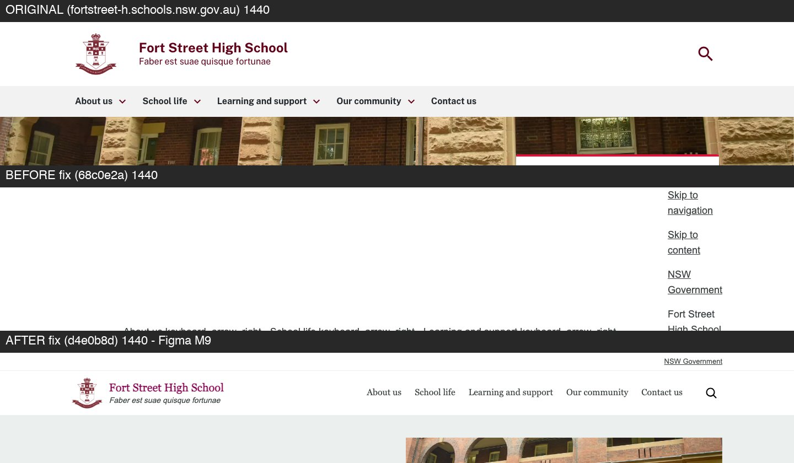 |
| 390 | 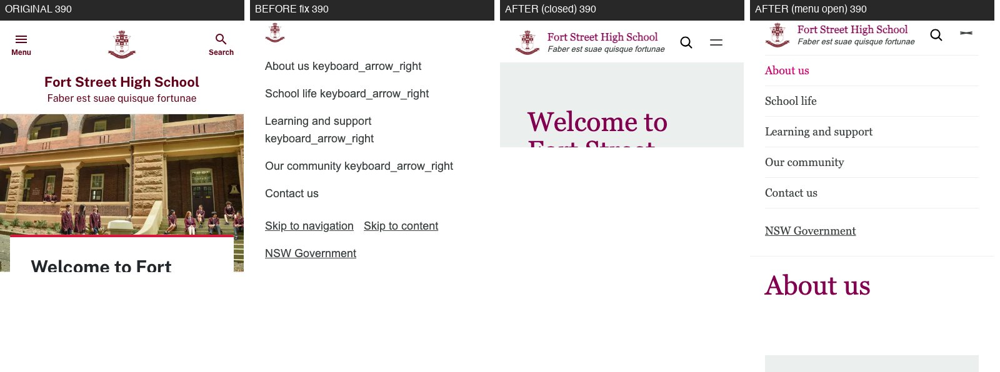 |

**Effect on the scores.** The header now matches the design, but the metrics move only a little and not all upwards. The mean pixel similarity rose 1.3 points (31 pages up, 21 down). Above-the-fold SSIM fell from 47.2 to 41.5. The old header was mostly a blank 529 px area, and blank white matched the original's white masthead well. Removing it moved every page's content up by about 400 px, and it no longer sits at the original's y-positions. Pixel and SSIM scores are position-sensitive, so they don't reward a correct redesign. Use the composites to judge.

### 2.2 Cards fix (after the first benchmark)

On every page the cards (52 pages, 7 variants) rendered as bulleted lists with 1.6em inline thumbnails instead of image cards.

**Why.** Capture was right: each source card is one `listItem` (image, link, text, arrow). The fault was the skill's renderer. `stream-render.mjs` `findRepeat` only detects repeats of 2 or more nodes, so it couldn't treat each list item as one card:
- **Home "difference" (3 items):** no repeat was found, so it fell back to `ul.list` with an inline icon.
- **Quick links (6 items):** a false 2-item repeat produced 3 grey panels of 2-item lists.

The EDS cards block was then built to match that prototype, and named `list` and `quick-links` after it. Neither name is a source or Figma variant. The deployed gates compare EDS to the prototype, so they passed. The eyeball check passed it too.

**Fix.** `blocks/cards/cards.{js,css}` was rebuilt to the Figma M2 Teaser / Card (`canon-source/assets/screenshots/teaser-card.png`):
- Image on top (16:9 cover), panel body, magenta Lexia title, text, accent arrow.
- The title link is stretched over the card.
- The source's "(opens in new window)" stays for screen readers only, with an icon.
- `list`/`quick-links` are 3-up; the sidebar variants (`dark`, `off-white`, `highlight`, `horizontal`, plain) are 2-up, as in the source. Both are 1-up ≤ 600px.
- No content change: the authored rows (picture | heading link + text) were already right.

| Section | Original · before · after |
|---|---|
| Home "difference" (`list`) | 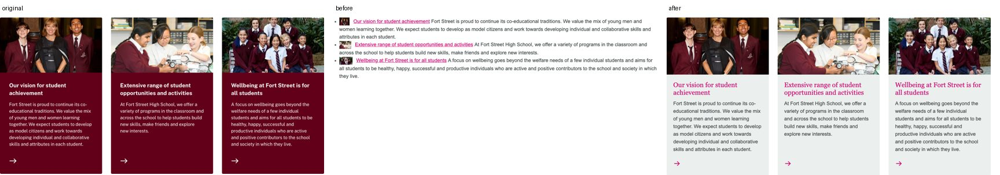 |
| Home quick links |  |
| School life (`dark`) | 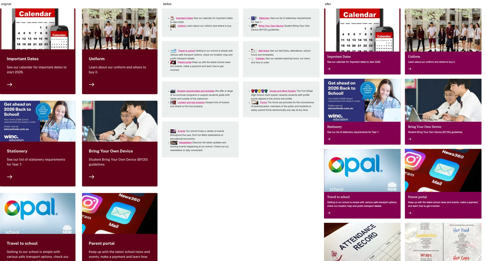 |
| Uniform (`horizontal`) | 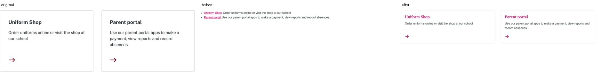 |
| Quick links at 390 | 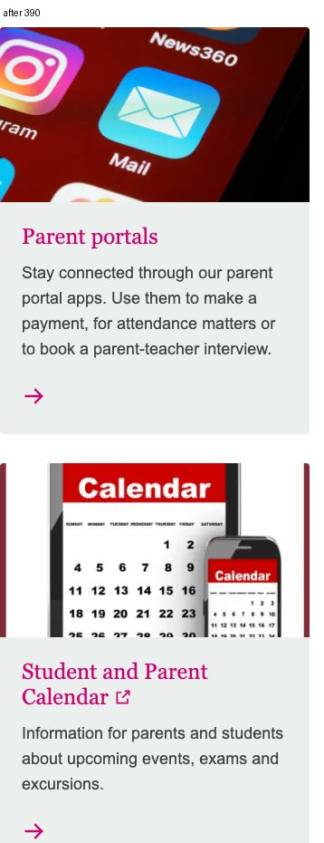 |

Block heights at 1440 now track the source: home 577 vs 567 px (was 229), quick links 935 vs 949 (was 409), school life 3796 vs 3345 (was 1118), uniform 202 vs 244 (was 56).

### Per-page fidelity, 1440px (sorted by pixel similarity)

| Page | Pixel similarity | SSIM overlap | SSIM height-norm | SSIM above-fold | Height orig → migrated (px) | Composite |
|---|---|---|---|---|---|---|
| `school-life-student-opportunities-and-activities-academic-competitions` | 86.4% | 42.48 | 41.21 | 42.05 | 5551 → 5252 | [compare](screens/compare/school-life-student-opportunities-and-activities-academic-competitions-1440.jpg) |
| `school-life-canteen` | 86.1% | 45.73 | 45.53 | 43.25 | 4360 → 3740 | [compare](screens/compare/school-life-canteen-1440.jpg) |
| `school-life-uniform-uniform-shop` | 84.2% | 40.2 | 40.32 | 48.21 | 5899 → 6680 | [compare](screens/compare/school-life-uniform-uniform-shop-1440.jpg) |
| `learning-and-support` | 82.7% | 49.17 | 43.81 | 52.57 | 1967 → 1285 | [compare](screens/compare/learning-and-support-1440.jpg) |
| `school-life-student-opportunities-and-activities-clubs-and-committees` | 82.7% | 44.57 | 39.28 | 43.76 | 4022 → 3732 | [compare](screens/compare/school-life-student-opportunities-and-activities-clubs-and-committees-1440.jpg) |
| `school-life-travel-to-school` | 82.0% | 41.56 | 41.59 | 49.6 | 6919 → 7477 | [compare](screens/compare/school-life-travel-to-school-1440.jpg) |
| `our-community-alumni` | 81.7% | 36.04 | 36.5 | 38.34 | 4299 → 3622 | [compare](screens/compare/our-community-alumni-1440.jpg) |
| `about-us-school-history-and-archives-fort-street-archives` | 81.5% | 45.42 | 42.98 | 39.57 | 5067 → 4803 | [compare](screens/compare/about-us-school-history-and-archives-fort-street-archives-1440.jpg) |
| `school-life-bring-your-own-device` | 81.4% | 38.02 | 40.2 | 35.61 | 4519 → 3734 | [compare](screens/compare/school-life-bring-your-own-device-1440.jpg) |
| `school-life-parent-portal` | 81.4% | 48.56 | 49.03 | 58.32 | 3731 → 3620 | [compare](screens/compare/school-life-parent-portal-1440.jpg) |
| `our-community-foundation` | 80.0% | 42.03 | 43.25 | 35.69 | 5668 → 5687 | [compare](screens/compare/our-community-foundation-1440.jpg) |
| `school-life-bell-times` | 79.8% | 36.66 | 36.54 | 44.41 | 3839 → 3942 | [compare](screens/compare/school-life-bell-times-1440.jpg) |
| `our-community-foundation-tertiary-bursaries` | 78.9% | 43.2 | 43.89 | 42.73 | 2408 → 2316 | [compare](screens/compare/our-community-foundation-tertiary-bursaries-1440.jpg) |
| `our-community-pandc` | 77.2% | 44.66 | 43.93 | 28.3 | 6275 → 6837 | [compare](screens/compare/our-community-pandc-1440.jpg) |
| `school-life-student-opportunities-and-activities-creative-and-performing-arts` | 76.7% | 42.07 | 41.3 | 39.27 | 3172 → 2964 | [compare](screens/compare/school-life-student-opportunities-and-activities-creative-and-performing-arts-1440.jpg) |
| `learning-and-support-wellbeing` | 76.5% | 42.86 | 34.84 | 34.32 | 5465 → 11342 | [compare](screens/compare/learning-and-support-wellbeing-1440.jpg) |
| `contact-us` | 75.7% | 50.1 | 49.38 | 55.11 | 3329 → 3981 | [compare](screens/compare/contact-us-1440.jpg) |
| `school-life-house-and-merit-system` | 75.6% | 42.75 | 42.43 | 48.88 | 5603 → 4803 | [compare](screens/compare/school-life-house-and-merit-system-1440.jpg) |
| `school-life-lockers-and-lost-property` | 75.0% | 43.54 | 43.58 | 40.51 | 3401 → 3221 | [compare](screens/compare/school-life-lockers-and-lost-property-1440.jpg) |
| `school-life-newsletters` | 74.6% | 45.51 | 45.43 | 55.6 | 3122 → 3888 | [compare](screens/compare/school-life-newsletters-1440.jpg) |
| `school-life-student-opportunities-and-activities-instrumental-music-program` | 74.4% | 36.51 | 36.85 | 30.78 | 5947 → 5699 | [compare](screens/compare/school-life-student-opportunities-and-activities-instrumental-music-program-1440.jpg) |
| `school-life-student-opportunities-and-activities-sport` | 74.1% | 43.53 | 44.02 | 44.78 | 3600 → 3587 | [compare](screens/compare/school-life-student-opportunities-and-activities-sport-1440.jpg) |
| `about-us-transition-to-high-school` | 74.0% | 42.35 | 43.62 | 38.93 | 3979 → 3858 | [compare](screens/compare/about-us-transition-to-high-school-1440.jpg) |
| `learning-and-support-learning` | 73.0% | 39.85 | 31.29 | 37.85 | 5123 → 15154 | [compare](screens/compare/learning-and-support-learning-1440.jpg) |
| `our-community-fortians-union` | 72.6% | 45.01 | 45.88 | 52.07 | 2300 → 2298 | [compare](screens/compare/our-community-fortians-union-1440.jpg) |
| `our-community` | 72.0% | 45 | 41.97 | 41.92 | 2547 → 1827 | [compare](screens/compare/our-community-1440.jpg) |
| `about-us-our-principal-and-staff` | 72.0% | 42.46 | 41.59 | 38.83 | 6986 → 7959 | [compare](screens/compare/about-us-our-principal-and-staff-1440.jpg) |
| `about-us-policies-and-reports` | 71.9% | 39.54 | 34.7 | 35.59 | 3647 → 5259 | [compare](screens/compare/about-us-policies-and-reports-1440.jpg) |
| `about-us-school-history-and-archives-the-fortian-digitised` | 71.3% | 51.03 | 48.94 | 42.85 | 3183 → 12832 | [compare](screens/compare/about-us-school-history-and-archives-the-fortian-digitised-1440.jpg) |
| `learning-and-support-additional-learning-support` | 71.2% | 37.69 | 33.03 | 38.27 | 4914 → 8224 | [compare](screens/compare/learning-and-support-additional-learning-support-1440.jpg) |
| `school-life-student-opportunities-and-activities-student-leadership-opportunities` | 69.7% | 36.74 | 36.89 | 38.01 | 3384 → 3872 | [compare](screens/compare/school-life-student-opportunities-and-activities-student-leadership-opportunities-1440.jpg) |
| `school-life-forms` | 69.4% | 38.32 | 38.47 | 43.72 | 1975 → 1928 | [compare](screens/compare/school-life-forms-1440.jpg) |
| `learning-and-support-high-potential-and-gifted-education` | 68.3% | 38.42 | 39.29 | 42.92 | 4365 → 5067 | [compare](screens/compare/learning-and-support-high-potential-and-gifted-education-1440.jpg) |
| `school-life-events` | 68.0% | 42.35 | 42.91 | 56.5 | 6411 → 6778 | [compare](screens/compare/school-life-events-1440.jpg) |
| `school-life-student-opportunities-and-activities-robotics-and-maker-society` | 67.6% | 41.68 | 38.34 | 40.18 | 2356 → 2186 | [compare](screens/compare/school-life-student-opportunities-and-activities-robotics-and-maker-society-1440.jpg) |
| `school-life` | 67.5% | 40.3 | 40.78 | 45.42 | 4342 → 2134 | [compare](screens/compare/school-life-1440.jpg) |
| `school-life-uniform` | 67.1% | 39.28 | 34.82 | 35.83 | 3574 → 5799 | [compare](screens/compare/school-life-uniform-1440.jpg) |
| `about-us-policies-and-reports-nsw-public-school-information` | 66.6% | 39.49 | 40.28 | 37.88 | 1876 → 1748 | [compare](screens/compare/about-us-policies-and-reports-nsw-public-school-information-1440.jpg) |
| `about-us-enrol` | 66.5% | 34.94 | 37.32 | 38.61 | 3941 → 5832 | [compare](screens/compare/about-us-enrol-1440.jpg) |
| `school-life-student-opportunities-and-activities-debating-and-public-speaking` | 66.2% | 37.58 | 36.7 | 36.79 | 2135 → 1994 | [compare](screens/compare/school-life-student-opportunities-and-activities-debating-and-public-speaking-1440.jpg) |
| `about-us` | 64.5% | 38.48 | 41.9 | 42.04 | 2857 → 1559 | [compare](screens/compare/about-us-1440.jpg) |
| `about-us-why-choose-us` | 63.2% | 40.32 | 37.53 | 40.9 | 6290 → 5822 | [compare](screens/compare/about-us-why-choose-us-1440.jpg) |
| `school-life-student-opportunities-and-activities` | 62.0% | 39.72 | 39.1 | 40.88 | 5270 → 6100 | [compare](screens/compare/school-life-student-opportunities-and-activities-1440.jpg) |
| `about-us-hsc-results` | 61.8% | 37.87 | 37.17 | 36.48 | 10845 → 11464 | [compare](screens/compare/about-us-hsc-results-1440.jpg) |
| `school-life-student-opportunities-and-activities-duke-of-edinburgh-award` | 61.4% | 40.35 | 38.91 | 37.59 | 7505 → 9673 | [compare](screens/compare/school-life-student-opportunities-and-activities-duke-of-edinburgh-award-1440.jpg) |
| `learning-and-support-careers` | 59.8% | 33.95 | 33.83 | 40.2 | 4084 → 4222 | [compare](screens/compare/learning-and-support-careers-1440.jpg) |
| `about-us-stories-and-highlights` | 59.6% | 31.74 | 29.76 | 41.9 | 3767 → 8417 | [compare](screens/compare/about-us-stories-and-highlights-1440.jpg) |
| `school-life-stationery` | 58.3% | 40.72 | 39.42 | 40.06 | 2006 → 1917 | [compare](screens/compare/school-life-stationery-1440.jpg) |
| `about-us-facilities-and-resources` | 56.5% | 32.79 | 31.35 | 46.81 | 3019 → 4577 | [compare](screens/compare/about-us-facilities-and-resources-1440.jpg) |
| `about-us-school-history-and-archives-the-fort-street-museum` | 51.6% | 32.87 | 33.35 | 33.87 | 3448 → 3833 | [compare](screens/compare/about-us-school-history-and-archives-the-fort-street-museum-1440.jpg) |
| `about-us-school-history-and-archives` | 48.1% | 30.41 | 32.98 | 42.42 | 5596 → 6778 | [compare](screens/compare/about-us-school-history-and-archives-1440.jpg) |
| `home` | 45.3% | 27.94 | 31.25 | 19.1 | 5951 → 4489 | [compare](screens/compare/home-1440.jpg) |

### Archetypes at 768 and 390

| Page | Width | Pixel similarity | SSIM overlap | Height orig → migrated (px) | Composite |
|---|---|---|---|---|---|
| `home` | 768 | 41.0% | 15.77 | 6645 → 6834 | [compare](screens/compare/home-768.jpg) |
| `home` | 390 | 45.3% | 10.11 | 8709 → 8043 | [compare](screens/compare/home-390.jpg) |
| `school-life` | 768 | 42.5% | 14.6 | 3881 → 2585 | [compare](screens/compare/school-life-768.jpg) |
| `school-life` | 390 | 36.5% | 11.56 | 6640 → 3799 | [compare](screens/compare/school-life-390.jpg) |
| `learning-and-support-wellbeing` | 768 | 70.6% | 25.66 | 5321 → 13007 | [compare](screens/compare/learning-and-support-wellbeing-768.jpg) |
| `learning-and-support-wellbeing` | 390 | 72.1% | 12.15 | 5922 → 18396 | [compare](screens/compare/learning-and-support-wellbeing-390.jpg) |

All 58 composites are in [`screens/compare/`](screens/compare/). Each is ORIGINAL | MIGRATED | DIFF, scaled JPEG. The full-resolution captures and diff masks were produced locally under `screens/{original,migrated,diff}/` (about 240 MB). They are not committed.

### 2.3 Footer fix and chrome gate (after the first benchmark)

The footer had dropped the Facebook and Instagram icons and the NSW Department of Education logo link. Those are icon-only links, and capture recorded only text links. The footer was rebuilt to Figma M10 (3 columns, then stacked and centred on mobile), and the DA `/footer` was updated.

| | Source · before · after |
|---|---|
| 1440 | 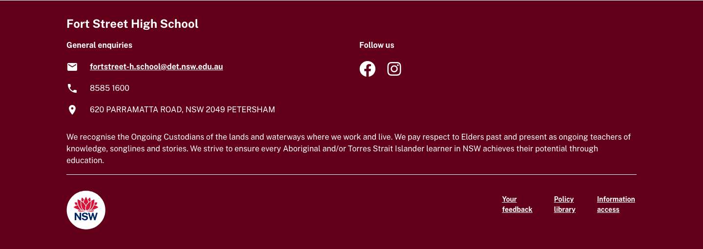 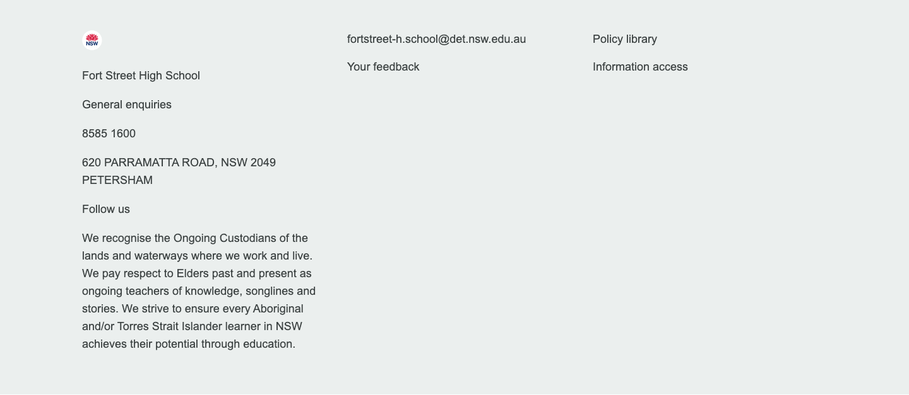 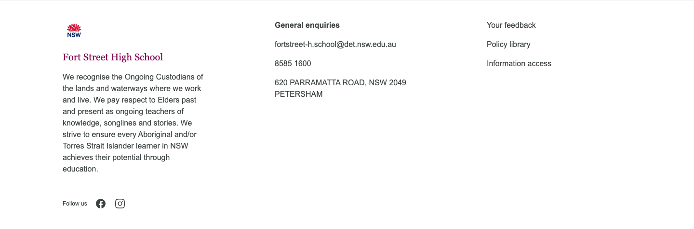 |
| 390 | 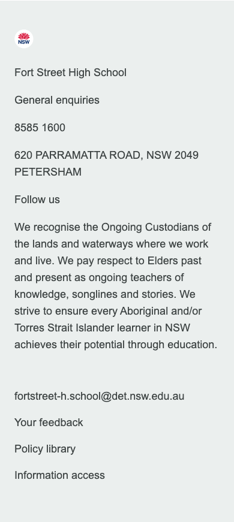 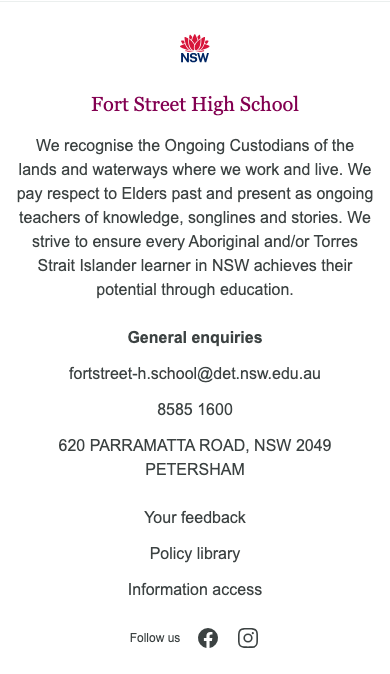 |

The new skill gate `deployed-gate chrome` (A6) checks the header and footer at 1440 and 360 against the source chrome model:

| Target | Verdict | Key rows |
|---|---|---|
| `fortstreet` home (after) | **PASS** 21/21 | footer links 7/7, text 10/10; header/main overlap 0; header 114/81 px |
| `/about-us`, `/contact-us`, `/learning-and-support` | **PASS** | same |
| `main` (old chrome) | **FAIL (hard)** | header covers main by 36/204 px; header links 5/6; 4 icon-ligature texts; footer logo 0 |

Evidence: `chrome-gate/after-home.json`, `chrome-gate/before-main.json`.

## 3. Blocks: how they are formed

Each block follows the same chain: **source DOM → normalize/reskin mapping (Figma module) → DA table (div-grid authors edit) → `decorate()` in `blocks/<b>/<b>.js` → rendered markup styled only with the `:root` Figma tokens in `styles/styles.css`.**

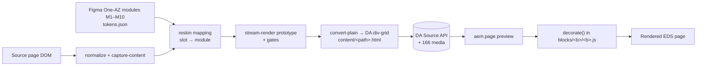

| Block | Pages | Figma module | DA table authors edit | What `decorate()` builds |
|---|---|---|---|---|
| **hero** | 44 | M1 hero | 1 column, 2 rows: picture, then h1 + intro/motto + CTA link | `.hero-panel` > `.hero-text` + `picture.hero-media`. Eager, high-priority image; light band on `.hero-container`. 2 columns, 1 at ≤900px |
| **cards** (`list`, `quick-links`, `dark`, `off-white`, `highlight`, `horizontal`) | 52 | M2 teaser list | Rows of `icon/picture \| title (h3>a or p) + text` | `ul.cards-grid > li.cards-card > div.cards-card-image + div.cards-card-body` (title, text, arrow; stretched title link). `list`/`quick-links` 3-up, the rest 2-up, 1-up ≤ 600px. `dark` maroon panel; sidebar variants white with a hairline; `highlight` adds an accent top rule |
| **columns** (`light`, `media-first`) | 33 | M3 teaser, M4 CTA banner | 1–5 rows of `text \| picture` (either order); text-only rows span the full width | `.columns-panel` > `.columns-text` + `picture.columns-media`. Button wrappers merge into `div.actions`. `light` puts the band on the section through `:has()` |
| **accordion** | 13 | M8 accordion | Rows of `title \| panel` (rich panel, nested tables allowed) | `.accordion-item > .accordion-head (.accordion-title + button.accordion-toggle chevron) + .accordion-panel`. Starts open |
| **table** (`bordered`, `no-header`) | 13 | — (type ramp + palette tokens) | One row per table row, 2–6 columns | `.table-scroll > table > thead/tbody`. The first row is `th` unless `no-header` |
| **gallery** | 6 | M2 card spacing/radius | Rows of `picture \| caption` | `ul.gallery-grid > li.gallery-item > .gallery-media + .gallery-caption` |
| **content-container** | 2 | M2 teaser card | Rows of `picture \| text` | `ul.content-container-grid > li > .content-container-media + .content-container-body` |
| **facebook-feed** | 3 | — (light band + link tokens) | 1 cell: link to the Facebook page | `.facebook-feed-panel` + action link. No third-party script |
| **planningreporting** | 1 | — (list + link tokens) | Key/value config rows: `reporttype`, `schoolcode` | Fetches the NSW school plan/report API → `ul.planningreporting-list > li > a`; on failure, links to the department page |
| **embed** | 0 authored (auto-blocked) | — | Plain link; `scripts.js` auto-blocks known hosts (Brightcove, Google Maps) | `.embed-frame` (16:9 placeholder + load button) + `.embed-source`. The iframe is created on click only |
| **header** | all (`/nav` fragment) | M9 header | 3 sections: logo \| `ul` of 5 nav links \| utility paragraphs | `.site-header` > skip links + `.nav-utility` + `.nav-bar > .nav-container` with `a.nav-brand` (logo, name, motto), `nav#main-nav > ul`, `.nav-actions` (search link + `button.nav-toggle`). Ligature text is stripped; the menu panel is under 1024px → **§ 2.1** |
| **footer** | all (`/footer` fragment) | M10 footer | 2 sections: logo + 6 info paragraphs \| `ul` of 4 links | `.site-footer > .container.chrome-footer` with `.footer-brand` + `ul.footer-links` |

Default content (headings above blocks, lone h2 sections) and `metadata` stay outside blocks. No section-metadata styles are used. Full per-block details: [`deploy-report.md`](deploy-report.md) (home blocks) and [`deploy-siblings-report.md`](deploy-siblings-report.md) (the 7 extra blocks).

### DA block library

11 blocks and 19 variant sections were published to the DA Library through the excat `block-library-creator` skill. Every block has a `metadata.json`, a sample page and an entry in `library/blocks.json`. All 11 render with 0 broken images. See [`block-library.md`](block-library.md) and the samples at `https://fortstreet--stardust-reskin-figma-migration--sanyasandal.aem.page/library/blocks/<block>`.

## 4. Unavailable or partial values

| Item | Status |
|---|---|
| USD cost | Unavailable. AIU is recorded; no USD rate is exposed |
| System prompt and tool definitions | Withheld (runtime-confidential). User and sub-agent prompts are verbatim in `prompts.md` |
| Tokens after 15:03Z | Not included (report writing, commit, PR) |
| Original 768/390 captures for the 49 non-archetype pages | Not taken. Only the 3 archetypes were compared at 768/390 |
| Composite builder script | Built inline during the session and not retained. The composites and `fidelity.json` are the artifacts |

## 5. Artifacts

- [`prompts.md`](prompts.md): exact prompts, secrets redacted
- [`fidelity.json`](fidelity.json): raw pixel and SSIM results for 58 captures
- [`screens/compare/`](screens/compare/): 58 side-by-side composites
- [`migration-steps.md`](migration-steps.md): every step taken
- [`archetypes-report.md`](archetypes-report.md), [`siblings/`](siblings/), [`deploy-report.md`](deploy-report.md), [`deploy-siblings-report.md`](deploy-siblings-report.md), [`block-library.md`](block-library.md)
- `stardust/reskin/ledger.json`: gate verdicts and residuals per page
- `stardust/.work/reskin/fidelity.mjs`, `ssim.mjs`, `extract-prompts.mjs`: measurement helpers
